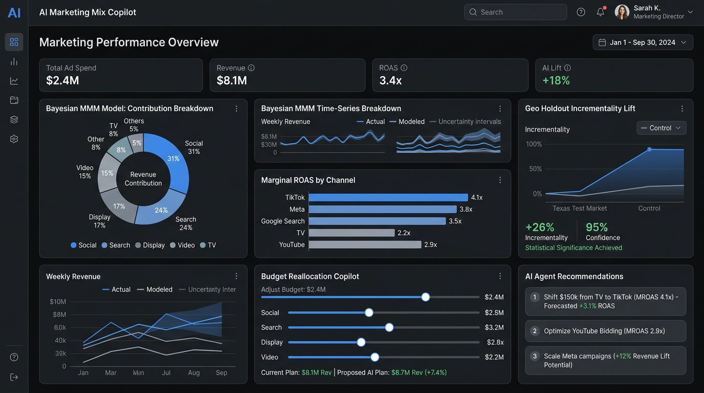

# Conversion Tracking Doctor 🩺📊

[](https://github.com/hamid-digitalmarketer/conversion-tracking-doctor/actions/workflows/ci.yml)
[](https://www.python.org/downloads/)
[](https://opensource.org/licenses/MIT)
[](https://github.com/astral-sh/ruff)
[](http://mypy-lang.org/)
[](https://abouthamid.web.app/)
[](https://www.linkedin.com/in/muhammad-hamid-digital-marketing/)
[](mailto:mhamidlad@gmail.com)

> **Diagnostic and audit engine for web conversion tracking (Google Analytics 4, Meta Conversions API, Google Ads Enhanced Conversions).**  
> Detects event duplicate firing, unhashed PII privacy leaks in URL query strings, broken Enhanced Conversions hashing, currency/value anomalies, and iOS/ad-blocker signal loss. Automatically exports ready-to-deploy **Google Tag Manager** custom JavaScript deduplication variables and **Meta CAPI** server remediation payloads.

---



---

## ⚡ The Problem: Silent Conversion Tracking Breakdowns

Modern digital marketing relies entirely on conversion data feeding automated smart bidding algorithms (Target CPA, Target ROAS, Advantage+). Yet conversion pipelines frequently fail silently:

1. **Phantom Revenue Duplication**: Users reloading thank-you pages re-fire purchase events, inflating reported ROAS by 20% to 50% and triggering aggressive, overpriced bidding.
2. **Unhashed PII Privacy Leaks**: Form builders and campaign redirects leak raw customer emails (`?email=`) and phone numbers into GA4 and Meta Pixel URLs, risking immediate ad account suspension and GDPR violations.
3. **Broken Enhanced Conversions**: Uppercase SHA-256 hashes, un-normalized whitespace, or plaintext strings cause ad platforms to reject customer match keys, wasting attribution recovery.
4. **100x Value Scale Errors**: Passing raw Stripe or Shopify integer cents as whole dollars ($299.90 passed as $29,990.00) completely corrupts automated bidding value models.
5. **Missing Deduplication Keys**: Browser pixel tags firing without matching `event_id` parameters to server CAPI webhooks cause platforms to double-count every single conversion.
6. **Severe iOS / Safari Signal Loss**: Third-party cookie blocking and ad-blockers drop 20%+ of browser conversion hits without server-side CAPI coverage.

**Conversion Tracking Doctor** analyzes raw GA4 client exports and Meta CAPI server logs, audits health with mathematical precision, and generates instant remediation snippets.

---

## 🚀 Key Features

- 🔍 **6 Specialized Diagnostic Engines**:
  - `DuplicateEventsAnalyzer`: Identifies repeat purchase firings and quantifies overcounted revenue.
  - `PIILeakAnalyzer`: Scans URLs, query parameters, and custom dimensions for unhashed email and phone numbers.
  - `EnhancedConversionsAnalyzer`: Validates 64-character lowercase SHA-256 user data hashing.
  - `ValueCurrencyAnalyzer`: Flags missing/invalid ISO 4217 currencies, zero values, and decimal scaling bugs.
  - `ClientServerDiscrepancyAnalyzer`: Audits `event_id` deduplication, computes Meta EMQ scores (0-10), and measures ad-blocker drop-off rates.
  - `EcommerceSchemaAnalyzer`: Validates GA4 recommended schemas (`items` array, `transaction_id`, standard event names).
- 🛠️ **Automated Remediation Code Generators**:
  - `gtm_transaction_deduplication.js`: GTM Custom JavaScript variable to prevent re-firing on page reloads via localStorage.
  - `gtm_pii_scrubber.js`: GTM Custom JavaScript variable to sanitize URLs before dispatching hits.
  - `meta_capi_remediation.py`: Complete Python script for robust server-side Meta CAPI integration.
  - `meta_capi_remediation.js`: Node.js server module for payload formatting and SHA-256 normalization.
- 📊 **Executive & Engineering Reports**:
  - **Interactive Tailwind CSS Dashboard**: Self-contained HTML report with responsive filtering and diagnostic payload inspector.
  - **JSON & Flat CSV Exports**: Machine-readable logs for automated CI/CD tag testing pipelines.
  - **SQLite Database Persistence**: Audit history stored locally in `reports/tracking_doctor.sqlite`.
- 🔒 **100% Privacy & Local Execution**: Runs locally without sending your proprietary transaction data to any third party.

---

## 📦 Installation

```bash
git clone https://github.com/hamid-digitalmarketer/conversion-tracking-doctor.git
cd conversion-tracking-doctor

# Install package in editable mode with development tools
pip install -e ".[dev]"
```

---

## 🛠️ Quick Start

### 1. Run Audit with Built-in Datasets
Test the diagnostic engine immediately using realistic synthetic multi-channel datasets:

```bash
conversion-doctor audit
```

To automatically launch the interactive HTML report in your browser:
```bash
conversion-doctor audit --open-browser
```

### 2. Audit Your Own Tracking Logs
Pass your GA4 event export CSV and Meta CAPI server log CSV:

```bash
conversion-doctor audit \
  --client-events path/to/ga4_client_events.csv \
  --server-events path/to/meta_capi_events.csv \
  --out-dir ./reports \
  --open-browser
```

### 3. Quick URL PII Inspection
Instantly verify whether a redirect or thank-you page URL leaks personal customer data:

```bash
conversion-doctor inspect-url "https://store.com/checkout/success?order=1042&email=user@test.com"
```

### 4. Serve the Web Dashboard Locally
```bash
conversion-doctor serve --port 8000
```
Browse your latest tracking audit at `http://localhost:8000`.

---

## 💻 Programmatic Python API

Embed `conversion-tracking-doctor` in your automated data warehouse audits or ETL jobs:

```python
from pathlib import Path
from data.loader import load_client_events, load_server_events
from conversion_tracking_doctor.analyzers import (
    DuplicateEventsAnalyzer,
    PIILeakAnalyzer,
    EnhancedConversionsAnalyzer,
    ValueCurrencyAnalyzer,
    ClientServerDiscrepancyAnalyzer,
    EcommerceSchemaAnalyzer,
)
from conversion_tracking_doctor.report import ReportGenerator

# Load CSV streams
client_rows = load_client_events("data/sample_data/ga4_client_events.csv")
server_rows = load_server_events("data/sample_data/meta_capi_events.csv")

# Run diagnostic analyzers
findings = []
findings.extend(DuplicateEventsAnalyzer().analyze(client_rows))
findings.extend(PIILeakAnalyzer().analyze(client_rows))
findings.extend(EnhancedConversionsAnalyzer().analyze(client_rows))
findings.extend(ValueCurrencyAnalyzer().analyze(client_rows))
findings.extend(EcommerceSchemaAnalyzer().analyze(client_rows))

disc_findings, overcounting_pct, emq, dropoff = (
    ClientServerDiscrepancyAnalyzer().analyze(client_rows, server_rows)
)
findings.extend(disc_findings)

print(f"Audit completed: Found {len(findings)} issues ({overcounting_pct}% overcounting, {emq}/10 EMQ score)")
```

---

## 📁 Repository Structure

```
conversion-tracking-doctor/
├── .github/
│   ├── ISSUE_TEMPLATE/        # Bug report and feature request templates
│   ├── workflows/ci.yml       # GitHub Actions CI matrix (Python 3.11, 3.12)
│   └── pull_request_template.md
├── data/
│   ├── loader.py              # Event stream CSV parser
│   └── sample_data/           # Synthetic real-world test datasets
│       ├── ga4_client_events.csv
│       └── meta_capi_events.csv
├── docs/
│   ├── architecture.md        # Technical pipeline architecture
│   ├── tracking_issues.md     # Tracking failure taxonomy & fixes
│   ├── usage.md               # CLI & API guide
│   └── report_preview.png     # Dashboard screenshot
├── reports/                   # Audit outputs (.html, .json, .csv, .sqlite, .js)
├── src/conversion_tracking_doctor/
│   ├── analyzers/             # 6 Specialized diagnostic engines
│   │   ├── duplicate_events.py
│   │   ├── pii_leak.py
│   │   ├── enhanced_conversions.py
│   │   ├── value_currency.py
│   │   ├── client_server_discrepancy.py
│   │   └── ecommerce_schema.py
│   ├── exporters/             # GTM snippets & server CAPI remediations
│   │   ├── gtm_snippets.py
│   │   └── capi_remediations.py
│   ├── templates/             # Jinja2 Tailwind CSS report template
│   │   └── report.html
│   ├── cli.py                 # Typer command-line interface
│   ├── models.py              # Pydantic data models
│   ├── report.py              # Multi-format report exporter
│   └── storage.py             # SQLite persistence engine
├── tests/                     # 12 Unit and integration tests
│   ├── test_analyzers.py
│   ├── test_cli.py
│   ├── test_exporters.py
│   └── test_report.py
├── CONTRIBUTING.md            # Contributor guidelines
├── LICENSE                    # MIT License
└── pyproject.toml             # Packaging and dependency configuration
```

---

## 🧪 Testing & Quality Assurance

```bash
# Run test suite
pytest -v

# Run code linter
ruff check .

# Run static type checker
mypy src
```

---

## 📄 License

This project is licensed under the [MIT License](LICENSE) - see the LICENSE file for details.

---

## 💼 Done-For-You Conversion Tracking & Server-Side CAPI Implementation

> **Stop losing 20% to 40% of your conversion data to iOS 14.5, Safari ITP, and ad blockers.** Broken tracking inflates reported CPAs, starves Meta/Google smart bidding algorithms, and leaks unhashed customer PII.

With **7+ years leading technical digital marketing & analytics infrastructure**, I help brands and agencies design robust, privacy-compliant tracking architectures that maximize smart bidding match rates and recover lost revenue attribution.

### 🎯 Available Services & Engagement Tiers

| Service Tier | Best For | What's Included | Typical Impact |
|---|---|---|---|
| **🔍 Forensic Tracking & Pixel Health Audit** | Brands spending \$15k–\$250k/mo | Full audit of GA4 event schema, Meta Pixel/CAPI deduplication, Google Ads Enhanced Conversions, and URL query PII scanning + remediation plan | Identifies duplicate purchase events and recovers missing 15–30% attribution |
| **⚙️ Turnkey Server-Side GTM & CAPI Setup** | E-commerce (Shopify/WooCommerce) & SaaS | Full Server-Side Google Tag Manager (sGTM) on Google Cloud or Stape, Meta Conversions API Gateway, and 1st-party cookie recovery | Achieves **8.5+ Meta Event Quality Score**, bypasses browser ad-blockers |
| **👑 Full Attribution & Marketing Analytics Retainer** | Scale-ups & high-volume media buyers | Continuous tag health monitoring, offline CRM conversion feedback (HubSpot/Salesforce), and multi-touch attribution reporting | Reliable ROAS reporting, automated alerting on tracking breaks |

---

### 🚀 Ready to Fix Your Tracking Infrastructure?

Schedule a technical consultation with **Muhammad Hamid**:

- 🌐 **Portfolio & Case Studies**: [abouthamid.web.app](https://abouthamid.web.app/)
- 💼 **LinkedIn Profile**: [linkedin.com/in/muhammad-hamid-digital-marketing](https://www.linkedin.com/in/muhammad-hamid-digital-marketing/)
- 📩 **Direct Business Email**: [`mhamidlad@gmail.com`](mailto:mhamidlad@gmail.com)
- 📅 **Book a Technical Audit Session**: [Schedule Discovery Call](https://abouthamid.web.app/)

<p align="center">
  <a href="https://abouthamid.web.app/"></a>
  <a href="https://www.linkedin.com/in/muhammad-hamid-digital-marketing/"></a>
  <a href="mailto:mhamidlad@gmail.com"></a>
</p>

---

## 👤 Author & Open Source Community

Created and maintained by **Muhammad Hamid** ([@hamid-digitalmarketer](https://github.com/hamid-digitalmarketer)).  
Submit an [issue](https://github.com/hamid-digitalmarketer/conversion-tracking-doctor/issues) or pull request to contribute new tracking checks!

