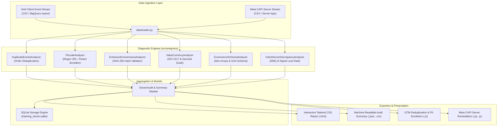

# Conversion Tracking Doctor - System Architecture

`conversion-tracking-doctor` is engineered as a zero-dependency local audit engine for web conversion tracking streams. It evaluates Google Analytics 4 (GA4), Meta Conversions API (CAPI), and Google Ads Enhanced Conversions for structural integrity, privacy compliance, and attribution accuracy.

---

## 1. High-Level Architecture

---

## 2. Core Diagnostic Engines

1. **`DuplicateEventsAnalyzer`**:
   - Groups client events by `transaction_id`.
   - Identifies rapid repeat firing (e.g. users refreshing thank-you pages or returning via browser history).
   - Computes phantom revenue and percentage overcounting.

2. **`PIILeakAnalyzer`**:
   - Evaluates full `page_location` URIs and query parameters against high-precision regular expressions for emails and telephone numbers.
   - Triggers `CRITICAL` warnings to prevent platform account bans under GDPR/CCPA and Google/Meta privacy policies.

3. **`EnhancedConversionsAnalyzer`**:
   - Assesses whether customer user data passed to Google Ads Enhanced Conversions and Meta Advanced Matching meets the mandatory 64-character lowercase hexadecimal SHA-256 specification.
   - Detects unhashed plaintext strings and uppercase hexadecimal anomalies.

4. **`ValueCurrencyAnalyzer`**:
   - Validates currency against the ISO 4217 currency list.
   - Identifies zero-value purchases, negative numbers, and 100x scale errors (raw cents sent as whole dollars).

5. **`ClientServerDiscrepancyAnalyzer`**:
   - Matches client events with server CAPI logs.
   - Checks presence of matching `event_id` keys necessary for platform-side deduplication.
   - Calculates Meta Event Match Quality (EMQ) score (0–10 scale) based on customer information parameter completeness.
   - Computes the client signal loss rate attributable to ad-blockers and Apple Safari Intelligent Tracking Prevention (ITP).

6. **`EcommerceSchemaAnalyzer`**:
   - Validates required fields (`transaction_id`, `items`, `value`, `currency`) for standard e-commerce events.
   - Detects non-standard event names that break GA4 funnel exploration reports.
